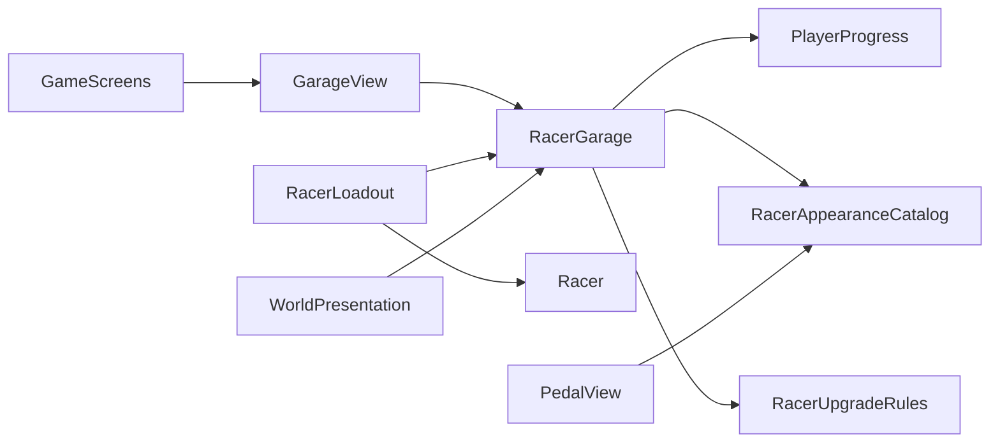

# Garage and racer upgrades

The garage opens from the bottom-left button while waiting at the start. It previews the selected model in the scene and offers acceleration, top speed, cooling and handling upgrades. Throttle input is disabled while the garage is open.

## Responsibilities

- RacerAppearanceCatalog supplies the model, name, pedal sprite, base RacerStats and stable upgrade ID.
- RacerGarage validates selection and purchases, updates PlayerProgress and emits SelectionChanged / UpgradesChanged. It has no dependency on UI or appearance views.
- RacerUpgradeRules computes prices and stat values from base settings and upgrade levels.
- RacerLoadout applies those values to a runtime copy of RacerStats; the source asset remains unchanged.
- GarageView renders selection, balance, prices and previews, and calls the garage model.
- WorldPresentation and PedalView display the selected appearance; GameScreens coordinates garage visibility and throttle input.

## Defaults

Edit Resources/RacerUpgradeRules.asset to tune balance. There are five levels per upgrade. Prices are 100, 200, 300, 400 and 500 points.

Each level adds 10% of base acceleration, 5% of base maximum speed, 20% of base cooling rate, or four percentage points to the green-zone threshold. Handling retains at least five percentage points of yellow zone and leaves the red threshold unchanged. Cooling affects heat recovery below the red zone; it does not slow heat accumulation inside the red zone.

Goose color variants share the goose upgrade ID. Car, tractor and goat have separate progress, with equal base settings initially. Individual base assets can be assigned in the catalog later.

Wallet stores available purchase points; Points remains cumulative for the leaderboard. Wins and quest rewards credit both. Existing saves migrate cumulative points into the wallet once, without resetting the record. Purchases and selected appearance persist through the existing PlayerPrefs profile.

## Editor verification

Checked save migration, purchase/reload without refunds, all four upgrade kinds, separate model records, shared goose colors, maximum levels, insufficient funds, invalid requests, blocked purchases during racing/pause, reward accounting, unchanged source settings, no compounded gains after model switching, garage input blocking, and script reload without duplicate garage canvases.

Measured cooling at rates 1 and 2: the latter removes twice as much heat in the same frame, while heating in the red zone remains unchanged. Inspected the garage and starting-menu layouts in portrait Game view. Test profile and leaderboard values were restored after verification. No player build was created.

## Speedometer maximum

The right end of the speedometer displays MAX followed by the selected racer's current maximum speed, including purchased upgrades. It uses the same speed units as RacerStats and does not assume a km/h conversion. Verified 100 -> 105 after a purchase, 100 for another unmodified model, restoration on switching back, enlarged green slider with a fixed red threshold, and one correctly bound label after script reload.
