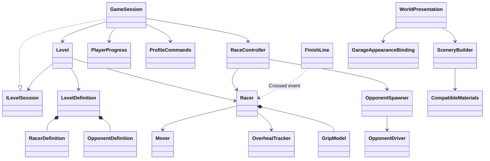

# Architecture audit resolution — 29 October 2026

Status: the actionable findings of the strict audit have been implemented. Verification commands and coverage are recorded in [Tests/Architecture](../../Tests/Architecture/README.md).

The historical [October 15 audit](audit-2026-10-15.md) and [October 27 integration decisions](merge-2026-10-27.md) remain unchanged. Their older speed-profile UI and source paths are historical.

## Resolved findings

- [x] Disabled Racer rejects ticks and stops movement. Disabled OpponentDriver stops its actor. Physics teardown tolerates an already destroyed body.
- [x] OpponentSpawner/WorldPresentation synchronize an existing route when enabled; created objects and materials have explicit owners.
- [x] Zero off-road grace does not lose while on the road; incomplete speedometer labels are supported safely; click volume is applied once.
- [x] GameSession owns campaign selection, rewards and persistence. RaceController owns attempt state, participant stepping, input, pause and result commitment. Results are typed and protected against reentrancy.
- [x] Level depends on the narrow ILevelSession preparation/state contract, not RaceController or the complete GameSession implementation. Known scene dependencies are assigned explicitly and validated.
- [x] PlayerProgress is an encapsulated model; PlayerProgressData is the legacy-compatible save DTO. Loading owns migration/normalization, including wallet, campaign, model ownership and selected appearance. DTO inputs and upgrade query results are copied.
- [x] PlayerProgressStore, LocalLeaderboard, ProfileCommands and QuestTracker are instance services. Views send commands and receive model data instead of writing save data. Preferences are not saved for every intermediate slider value.
- [x] Currency/counters saturate instead of overflowing; payments and upgrade progression validate before spending. Leaderboard identity is independent of display name.
- [x] QuestId and shared QuestDefinitions replace magic quest identifiers and independently maintained title/target/reward lists.
- [x] LevelDefinition includes immutable player and opponent definitions: physics, navigation, spawn poses, opponent driving parameters and vehicle reference. JSON/native reload snapshots restore both actors. Level owns spawn placement; the driver only selects throttle.
- [x] Candidate settings, geometry and preparation dependencies are validated before removing the current road. The commit boundary precedes observer notifications. Listener errors are reported separately and do not skip later observers or invalidate a committed replacement.
- [x] WorldPresentation delegates to SceneryBuilder, CompatibleMaterials and GarageAppearanceBinding. Scenery observes profile changes, independently of UI callbacks.
- [x] Localizer centralizes language selection; menu chrome refreshes on model/state/visibility events. Race status avoids redundant string updates; navigation references are cached. Nested menu decision expressions were extracted into named methods/switches.
- [x] ThrottleInput, UseEnglish, SelectedAppearanceIndex, SelectedSceneryIndex, Balance and ModelId describe their actual purpose. Obsolete Accelerate/Cooldown full-step wrappers were removed. Grip remains separate from overheating and Mover remains a movement executor.
- [x] Unused ShowSpeedHints/PathLineColor settings and runtime speed-profile allocation were removed. The advisory calculation survives only as tested Editor diagnostics. Yellow straights, green bends and blends remain the runtime rule.
- [x] Runtime sources are grouped by domain namespaces/folders. Script GUIDs were preserved (97 original script GUIDs checked, none missing or duplicated). MovedFrom/FormerlySerializedAs and explicit scene wiring support migration. Scene checks find zero missing scripts.
- [x] Mesh tooling lives in Editor; mirrored static geometry preserves submeshes/channels and reflects normals/tangents. A dedicated geometry regression check covers the supported data.
- [x] The Roslyn convention checker enforces member order, Unity callback exceptions, explicit false comparisons and control-flow/member spacing, including tests. Tool output and generated suites remain ignored.
- [x] A single PowerShell runner performs style + all 17 Editor suites, automatically backs up/restores preferences before/after Play Mode, restores the live profile, and fails on unexpected Unity errors.

## Current responsibilities

| Namespace / components | Responsibility |
|---|---|
| Levels: GameSession | Application workflow, campaign progression and result persistence. Composes profile services and implements the level-facing contract. |
| Levels: Level, LevelDefinition, ILevelSession | Road ownership/replacement and explicit participant preparation; immutable conditions; narrow session boundary. |
| Racing: RaceController | One attempt's state/result, pause/input and the simulation step of both participants. Existing scene/menu action methods delegate campaign work to GameSession. |
| Racing: Racer / Mover / Movement / Steering / BodyRotation | Actor coordination; executing movement; linear velocity; steering direction; body rotation. |
| Racing: GripModel / OverheatTracker | Slip rule; deterministic heat/cooling/explosion. |
| Racing: FinishLine / OpponentSpawner / OpponentDriver | Crossing sensor; owned opponent creation/configuration; throttle decision. |
| Roads | Route generation, sampled spacing validation, construction, curve queries, navigation and off-road rules. |
| Profile | Runtime invariants, save DTO/store, quest definitions/rules, user commands and local records. |
| Garage | Selection/preview/purchase/upgrade operations and applying selected loadout. |
| Settings | Editable assets, composite catalog records and immutable validated parameter snapshots. |
| Presentation | UI, shared localization, visuals, audio, scenery and view bindings. |
| Input | Keyboard/pointer adapters and combined throttle state. |
| Infrastructure | Isolated, observable event publication. |
| Editor / Tools | Editor diagnostics and mesh asset authoring; reusable geometry transformation. |

## Verification and deliberate boundaries

Unity 6000.3.6f1, Unity CLI beta.14: Editor compilation and 17 suites pass, including ten attempts, 100 seeds, actual input wiring, model-driven scenery/localization, observer failure isolation, reload recovery, stable player identity and mesh-channel preservation. An actual script reload was also exercised; first-frame restoration retains level 1 / seed 2608945 and opponent maximum speed 80. No missing scene scripts. The intentionally failing observer produces one expected exception log; unexpected errors fail the suite. No player build was created.

Replay snapshots retain native prefab references; they do not embed copies of mesh/material asset contents. Road spacing validation remains a sampled approximation, and the optional Editor speed profile remains advisory. Model catalog entries intentionally compose visual and economic configuration data; they contain no purchasing logic. Small immutable color/hash caches and Unity/CLI static entry points remain intentional. These are explicit boundaries, not unfinished audit fixes.
